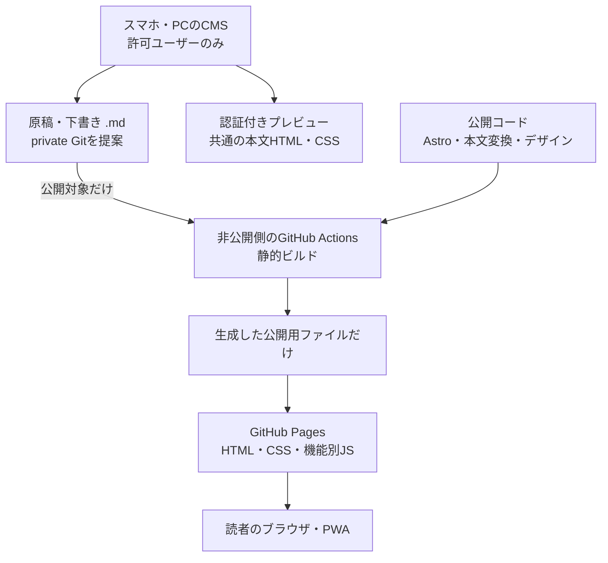
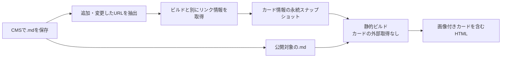
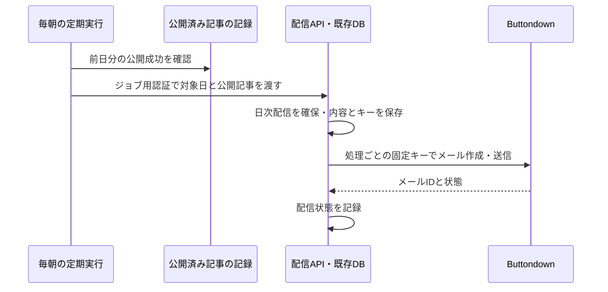

# アーキテクチャ案

更新日: 2026-11-13

公開側のAstro採用は確定。CMS・保存方式など未決定部分は設計の提案として記載する。アプリ実装・サービス設定は未実施。[確定要件](requirements.md)と[現行連携](current-integrations.md)を前提にし、今回の作業範囲は構成案を固めるところまで。

**公開ブログはAstroで.mdから静的HTMLを生成し、HTML・CSSと機能別の小さなJavaScriptをGitHub Pagesへ配信する。** リンクカードは必須、画像はCloudinaryを継続する。CMS・保存方式は未決定。Astroへの移行でも、既存記事の表示互換とビルド時間を検証する。

## 1. 公開側の技術選定

Astroを採用する。以下は選定時に比較した選択肢と判断理由。

| 候補 | 向いている理由 | 比較する点 |
| --- | --- | --- |
| Astroの静的生成（採用） | HTML・CSSの部品化とremark/rehypeへの接続を整理しやすく、必要な部分だけJavaScriptを追加できる | 既存本文の互換性とビルド時間は実装時に検証する |
| Eleventy | HTMLテンプレートを中心に構成でき、ブラウザ用のUIランタイムを必須にしない | 標準はmarkdown-it。共通のremark/rehype変換との接続が必要。WebCは任意の部品化手段 |
| Hugo | Markdown・記事一覧・RSSなどを備えた静的サイト生成ツール | 既存のNode製変換処理やCMSプレビューを直接共有しにくく、移植範囲が増える |
| NodeのMarkdown変換＋Vite | 出力と構成を細かく制御できる | Vite単体には記事管理・Markdown生成が揃っておらず、一覧・ページング・RSSなど自作の範囲が増える |
| 現行Next.jsの静的出力 | 既存実装を再利用しやすく、GitHub Pagesにも対応 | 現行React・Chakra・クライアント側本文表示をそのまま維持すると、読者向けJSの削減で不利になる |

Astroは静的生成モードでビルド時に利用し、通常の複数HTMLページと `<a>` による画面遷移を使う。公開側の初期構成ではReact統合・ClientRouterを入れず、必要な操作はHTMLネイティブ機能と小さなJavaScriptで実装する。GitHub PagesではAstroのリクエスト時サーバー処理を使わず、動的処理は別APIに任せる。

HTML/CSSでデザインを作り込む自由度は、これらの生成ツールのどれでも確保できる。生成ツールの名前だけで表示速度やビルド時間を断定しない。CMSは別のアプリなので、既存のReact/Next.jsを使い続けても公開ブログの配信量には加算されない。

## 2. 原稿から公開まで



- 公開コードはnew-2で検証し、最終的に本番リポジトリへ反映する。CMSはcmsリポジトリに置く。
- 原稿用のprivateリポジトリを別に用意する案。公開確定版と編集中の変更をブランチ・PRで分け、公開ビルドは確定版の公開対象だけを読む。
- ビルドはprivate側で行い、本番リポジトリのmainに公開コード、gh-pagesブランチに生成物だけを置く案。通常の `GITHUB_TOKEN` は別リポジトリへの書き込み権限を持たないため、対象を限定したGitHub Appなどの接続が必要。
- 公開状態と日時の両方で対象を判定する。`publishedAt` があるだけで公開扱いせず、`index:false` を非公開判定に使わない。
- 本文HTML、記事一覧、検索、RSS、sitemap、OGP、公開済み記事の記録は同じ対象記事から生成する。下書きや原稿用ファイルを公開成果物へ含めない。
- デプロイ成功と配信先のrevision確認後に公開完了を記録する。ビルド成功だけでは公開完了にしない。

## 3. HTMLネイティブを使う境界

| 機能 | 基本の実装 |
| --- | --- |
| 記事・一覧・ページング | `article / header / nav / main / time` と通常の `a`。本文は初期HTMLに含める |
| 開閉する説明・目次 | `details / summary` |
| 画像拡大・確認ダイアログ | 元画像への `a` を基本に、`dialog` と最小限の操作コードで拡張 |
| 軽いポップオーバー | `popover / popovertarget`。未対応環境でも必要な情報へ到達できる形にする |
| メール購読 | `form method="post"`、`input type="email"`、標準の入力検証。サーバーで登録し、日本語の結果ページへ戻す |
| 記事内リンク・ページ遷移 | 通常の `a` とCSSのクロスドキュメントView Transitions。未対応時は通常遷移 |
| 画像 | `img / picture`、`srcset / sizes`、サイズ指定、必要に応じた遅延読み込み |
| スマホ・装飾・動き | Grid/Flex、カスタムプロパティ、コンテナークエリー、CSSアニメーション。動きを減らす設定に対応 |

検索・いいね・コメント取得・閲覧履歴・インストールボタンなど、HTMLだけでは完結しない処理には機能別のJavaScriptを使う。Web Componentsは部品の独立性が必要な場合の候補とし、単純なフォームや開閉をすべて独自要素へ置き換えることはしない。

## 4. Markdown・デザイン・プレビューの共通化

```text
.md ＋ frontmatter
  → 公開判定・記事情報の検証
  → 共通のMarkdown変換（remark/rehype）
  → 本文HTML・見出し情報・検索用テキスト・記事情報
  → 公開ページ / 認証付きプレビュー
```

- 原稿は.mdを維持する。新しい原稿でMDXやReact部品を書くことを前提にしない。
- 既存のGFM・HTML・見出しリンク・コードハイライトの変換規則を流用する。現行は.mdをMDXとして解釈しているため、独自タグ・式などの実利用を確認し、未知の構文を黙って削除しない。
- 現行リンクカード処理はMDXの `LinkCard` ノードを作り、SNSの単独URL変換はReact部品にある。新構成ではこれらを生成時のHTML変換へ移す。
- 公開コードに小さな共通パッケージを置き、本文変換、記事HTMLの構造、CSS、デザイントークン、埋め込み補助コードを共有する。CMSへは固定バージョンで配布する案。
- CMSプレビューは許可ユーザーだけが特定の保存済み原稿を確認できるルートにし、共通の変換結果・本文CSSを使う。HTML・API・未公開素材も認証の対象にする。下書きHTML・API応答は `Cache-Control: private, no-store` とし、共有CDNへ保存しない。
- 現行プレビューAPIには `publicProcedure` があるため、そのアクセス制御を確認せず移植しない。本文変換設定も公開側・CMS側に重複しており、共通化する。
- デザインは書体・余白・色・線・レイアウト・動きをCSSのトークンと部品で作り込む。具体的な世界観は、実記事を使うラフで選ぶ。

本文・画像・リンクカードはJavaScriptなしで読める形を基本とし、SNSや動画の外部スクリプトは表示付近または操作時に読み込む。GA・Clarityは維持するため、サイト全体のJSゼロとはせず、独自コードと第三者コードの転送量・実行量を分けて測る。軽量化の数値目標は実記事で測定して決める。

## 5. リンクカードとビルド時間

### 現行コードで確認した負荷の候補

対象は現行調査と同じコミット。コードの呼び出し関係を確認した結果であり、時間の実測や主原因の特定はまだ行っていない。

| 処理 | 確認したこと |
| --- | --- |
| ビルド順 | `build` 内で検索データ生成、リンクカード生成、`next build` を直列に実行 |
| カード取得 | 既存manifestにあるURLは取得を省略。一方、未収録URLとfavicon候補を逐次取得し、fetchの明示的な期限がない。失敗結果はmanifestに保存しない |
| 本文変換時のカード | manifestにない場合は再び外部取得へ進み、その結果を永続保存しない |
| 記事情報 | 各記事ページから `getPostList()` を呼び、全記事のslug・公開日・frontmatterを繰り返し読み込める構造。該当関数内にメモ化がない |
| OGP | 本文をコンパイルする処理ではないが、記事ごとの画像生成でロゴ・フォントの読み込みと画像描画を行う |
| キャッシュの保存先 | CMSのPR作成でカード情報と画像を含める経路はある。一方、Actionsのビルド中に追加したmanifest・画像はソースへ戻されず、専用キャッシュもない |

現行のカード画像生成スクリプトは取得した画像をローカルへ保存する処理で、画像の再圧縮処理はない。Cloudinaryの画像loaderも配信URLを組み立てる処理。この2つを「毎回重い画像変換をしている」とは扱わない。

### 提案する分離



- URL正規化・カード判定・SNS埋め込みの除外規則をCMSと公開側で共通化する。
- HTMLからのタイトル・説明・画像・favicon抽出はOSSを優先し、open-graph-scraperやmetascraperを既存URLで比較する。採用ライブラリは未決定。サイトごとの抽出規則を一から自作する範囲を抑える。
- ブログ側で実装する範囲は、URLの差分検出、取得結果・再試行状態の永続保存、画像の保存先との連携、カードのHTML/CSSを中心とする。使える既存処理は流用する。
- 取得対象は新しいURLと明示的な更新対象に絞る。時間のかかる取得は編集画面を止めずに行い、状態を永続保存する。実行する基盤は既存Actionsなどを比較する。OSSへの置き換えだけで速度が改善するとは扱わない。
- 成功した情報に加え、処理中・失敗・次回再試行日時も保存する。短いタイムアウト、制限した並列数、ホスト単位のfaviconキャッシュを使う。失敗しても過去の成功データを消さない。
- メタデータの保存先は原稿と同じprivate領域を候補とする。公開ビルドへ渡すのは公開記事が参照するスナップショットだけとし、下書き用カード情報も含む全キャッシュを公開しない。
- 公開ビルドは取得済み情報を読み、カードを静的HTMLとして出力する。プレビューも同じスナップショットを使う。リンク先の応答待ちを公開ビルドへ戻さない。初回未取得のカードはドメイン・URL等で縮退表示するか、公開前の準備完了を待つかを決める。
- 既存のカードJSON・画像は移行に利用する。カードを単なる文字リンクへ一括置換して高速化する案にはしない。

### 記事・画像の処理

- 記事一覧・frontmatter・タグ索引を1回の読み込みで作り、各記事・一覧・RSS・メール用記録で共有する。
- 重い本文HTML変換のキャッシュキーには、原稿、変換器・プラグイン・ハイライト設定、その記事が使うカードの表示データを含める。カード更新でも参照記事の本文を更新する。
- 本文のキャッシュと完成ページのキャッシュは分ける。記事追加時の前後記事・関連記事・ページングは最新の共通索引で組み立てる。削除・非公開化した記事をキャッシュから公開出力へ戻さない。
- OGPは記事タイトル・テンプレート・ロゴ・フォントが変わった場合に再生成し、結果を次のビルドでも使える場所へ保存する案。
- アップロード画像はCloudinaryを継続する。CMSで保存前に1280px縮小・圧縮し、画像の寸法も保存する。公開ビルドは画像URLと寸法から `img / srcset` を出力し、画像の全件ダウンロードや再加工を行わない。
- 新たにカード画像を保管する場合もCloudinaryへ集約する案。既存の `/link-card/*` 画像はURL互換を保ち、移行を速度改善の前提にはしない。

全件ビルド、記事1本追加、カード情報更新、キャッシュなし、外部取得失敗を比較する。時間は依存関係の準備・リンク情報取得・本文変換・検索・OGP・HTML出力・デプロイに分けて測る。現行とAstroで同じ記事・カードデータ・必要機能の条件を揃え、互換性と改善効果を検証する。Astroへの変更だけで高速化できるとは扱わない。

## 6. 検索・反応・購読API

| 処理 | 提案 |
| --- | --- |
| 全文検索 | 生成HTMLを索引化するPagefindを候補に、既存の遅延取得＋Worker検索と比較。日本語・本文検索・年とタグ・URL保持・公開日順を検証して選ぶ |
| いいね・コメント | 既存の公開APIとPostgresを再利用。記事slug・匿名ID・既存データとSlack通知を維持 |
| 購読登録 | 公開APIへ通常のHTMLフォームでPOSTし、Buttondownで登録確認を行う。キーはサーバー側に置く |
| CMS | 公開APIとは別に保護し、原稿・Git権限・認証情報を扱う |
| 外部連携 | Webmention、GA、Clarity、Search Console、共有・フォロー・支援は現行連携の一覧に沿って引き継ぐ |

公開APIは既存の独立した配置を継続する案。CMS全体の認証と読者の公開APIを分ける。購読・反応のAPIへprivate原稿の読み取り権限は渡さない。利用元の設定と入力検証も移行時に確認する。

Pagefindは日本語にも対応するが、現行検索の部分一致・日付順と検索結果の意味が一致するかは未検証。ライブラリ採用だけで既存検索を満たしたとは扱わない。

## 7. 毎朝のメール



起動元はprivate原稿リポジトリのGitHub Actionsを第一候補とする。日本時間の前日分を1通にまとめ、記事ゼロなら送らない。Actionsは遅延・実行の欠落があり、朝の厳密な定刻保証はしない。必要な時刻精度に応じて起動元を決める。

配信の起動・状態操作には専用のジョブ用認証を必須とする。読者の購読登録・いいね・コメント用の公開エンドポイントから配信処理を起動できないようにする。

Postgresに対象日が一意の配信記録を持たせ、確定した本文、作成用・送信用それぞれの再試行用キー、ButtondownのメールIDを保存する。処理ごとに固定した `X-Idempotency-Key` を使い、再試行では同じ処理のキーを再利用する。既存メールIDから状態を確認し、応答が不明なまま新しいメールを作り直さない。キーの保持期間などは実接続で確認が必要。

原稿の編集用公開日時と、実際の公開完了時刻は分けて記録する。遅れて公開された記事を前日分へどう含めるか、失敗後の再開・送信時刻・本文全文か要約かは未決定。公開失敗を「対象記事ゼロ」と取り違えない。

## 8. PWA

PWAインストールは追加する要件。既存のmanifest・アイコンを引き継ぎ、軽量なインストールUIを追加する案。

- HTTPS、manifestの名前・アイコン・`start_url / scope / display` を整える。検証用PagesのbasePathと本番URLを区別する。
- Androidの対応Chromiumブラウザでは、`beforeinstallprompt` を受け取った場合にインストールボタンを表示し、クリックでブラウザの確認画面を開く。このイベントは非標準・対応環境限定で、全Android端末での表示は保証しない。
- インストール済みの場合はボタンを隠す。iOSなどには、対応するホーム画面追加の操作を案内する。
- 現行のインストール条件ではService Workerは必須ではない。最初はmanifestと小さなボタン処理を中心とし、オフライン用キャッシュは別に設計する。
- オフライン読書・プッシュ通知は今回のインストール要件だけでは確定しない。キャッシュを導入する場合もCMS・非公開原稿・API応答を一括保存しない。

Android実機でインストール・起動・ボタン非表示を確認する。manifestがあるだけで実機の動作確認済みとは扱わない。

## 9. AMPの判断

**今回の構成ではAMPを採用しない案を推奨する。** AMPは現在も利用できるが、専用の記法とJavaScriptランタイムが必要で、その形式に合わせた検証・埋め込み・計測の対応が増える。HTMLネイティブを優先する目的では、通常HTML/CSSを直接軽量化する方が単純。

Googleは2021年にTop StoriesのAMP必須条件を撤廃。さらに2026-07-01の公式更新で、AMP viewer・AMP Cache・signed exchangeへの古い説明を削除し、検索から配信元のAMPページへ直接誘導する方式へ変更した。通常ページと同じ基準で検索に扱われるため、AMP採用による検索上の優遇を前提にしない。

## 10. 実装へ進む前の比較と最初の確認

1. 写真・コード・表・リンクカード・SNS埋め込みを含む既存記事で、.mdからの静的HTML変換と表示互換を確認する。
2. 記事一覧・記事詳細・日本語の購読フォーム・PWA導線を、CSS中心のラフで比較する。
3. 共通の本文HTMLとCSSで、公開ページと認証プレビューが揃うことを確認する。
4. 現行admin改修を優先検証し、Sveltiaのスマホ操作・原稿保存・カスタムプレビューと比較する。Sveltiaの.md／.mdxファイル保存対応と既存MDX表示の互換性は別に確認する。
5. API・既存DB・外部連携を接続し、日次メールはまず送らずに対象日・ゼロ件・重複・公開失敗を検証する。
6. 保存方式、CMS、Cloudinaryでの非公開画像の扱い・動画の保存先、共有パッケージの配布方式を決める。公開側は採用したAstroで実装する。

Google PhotosはCMS側へ追加し、画像は保存前の横幅1280px縮小・圧縮を経てCloudinaryへ保存する。写真・動画をGitへ大量保存する構成は避ける方向。既存Cloudinary画像URLは維持し、未公開画像の閲覧制限と動画の保存方式は別途選ぶ。

確認には操作動画、構成図、日次配信のシーケンス図、Cucumberの受け入れシナリオを使う。設計資料の時点では、これらの実行結果はまだない。

## 11. 参照

- [Astroの静的コンポーネントと必要部分のJavaScript](https://docs.astro.build/en/concepts/islands/)
- [AstroのMarkdown・remark/rehype](https://docs.astro.build/en/guides/markdown-content/)
- [EleventyのMarkdown](https://www.11ty.dev/docs/languages/markdown/)
- [EleventyのWebC](https://www.11ty.dev/docs/languages/webc/)
- [Hugoの機能](https://gohugo.io/about/features/)
- [Viteのビルド](https://vite.dev/guide/build.html)
- [open-graph-scraper](https://github.com/jshemas/openGraphScraper)
- [metascraper](https://github.com/microlinkhq/metascraper)
- [現行ビルドコマンド](https://github.com/silverbirder/silverbirder.github.io/blob/54f14a4550505a09c1bef67e7449f2f90e295d55/apps/user/package.json)
- [現行カード情報・画像の収集](https://github.com/silverbirder/silverbirder.github.io/blob/54f14a4550505a09c1bef67e7449f2f90e295d55/apps/user/scripts/generate-link-card-assets.mjs)
- [現行カードのmanifest参照と外部取得](https://github.com/silverbirder/silverbirder.github.io/blob/54f14a4550505a09c1bef67e7449f2f90e295d55/apps/user/src/libs/link-card.ts)
- [現行カード判定の除外規則](https://github.com/silverbirder/silverbirder.github.io/blob/54f14a4550505a09c1bef67e7449f2f90e295d55/packages/util/src/remark/remark-link-card-guard.ts)
- [現行記事情報の読み込み](https://github.com/silverbirder/silverbirder.github.io/blob/54f14a4550505a09c1bef67e7449f2f90e295d55/apps/user/src/libs/posts/posts.ts)
- [現行記事一覧の生成](https://github.com/silverbirder/silverbirder.github.io/blob/54f14a4550505a09c1bef67e7449f2f90e295d55/apps/user/src/libs/posts/get-post-list.ts)
- [現行記事ページ](https://github.com/silverbirder/silverbirder.github.io/blob/54f14a4550505a09c1bef67e7449f2f90e295d55/apps/user/src/app/blog/contents/%5Bslug%5D/page.tsx)
- [現行記事別OGP生成](https://github.com/silverbirder/silverbirder.github.io/blob/54f14a4550505a09c1bef67e7449f2f90e295d55/apps/user/src/app/blog/contents/%5Bslug%5D/opengraph-image.png/route.tsx)
- [現行の本文変換設定](https://github.com/silverbirder/silverbirder.github.io/blob/54f14a4550505a09c1bef67e7449f2f90e295d55/apps/user/src/libs/mdx/mdx-options.ts)
- [現行のプレビューAPI](https://github.com/silverbirder/silverbirder.github.io/blob/54f14a4550505a09c1bef67e7449f2f90e295d55/apps/admin/src/server/api/routers/mdx.ts)
- [Sveltiaのプレビュー](https://sveltiacms.app/en/docs/api/preview-templates)
- [Pagefindの多言語検索](https://pagefind.app/docs/multilingual/)
- [クロスドキュメントView Transitions](https://developer.mozilla.org/en-US/docs/Web/CSS/Reference/At-rules/@view-transition)
- [PWAのインストール条件](https://web.dev/articles/install-criteria)
- [インストールボタンの対応範囲](https://developer.mozilla.org/en-US/docs/Web/Progressive_web_apps/How_to/Trigger_install_prompt)
- [インストールとService Worker](https://developer.mozilla.org/en-US/docs/Web/Progressive_web_apps/Guides/Making_PWAs_installable)
- [Google Searchの2026年更新](https://developers.google.com/search/updates)
- [Google SearchにおけるAMP](https://developers.google.com/search/docs/crawling-indexing/amp)
- [Top StoriesのAMP条件撤廃](https://developers.google.com/search/blog/2021/04/more-details-page-experience)
- [AMP HTMLの必須ランタイム](https://amp.dev/documentation/guides-and-tutorials/learn/spec/amphtml)
- [GitHub Actionsのschedule](https://docs.github.com/en/actions/reference/workflows-and-actions/events-that-trigger-workflows#schedule)
- [GITHUB_TOKENの権限](https://docs.github.com/en/actions/concepts/security/github_token)
- [Buttondownの冪等キー](https://docs.buttondown.com/api-idempotency-keys)
