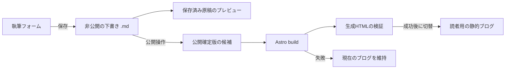
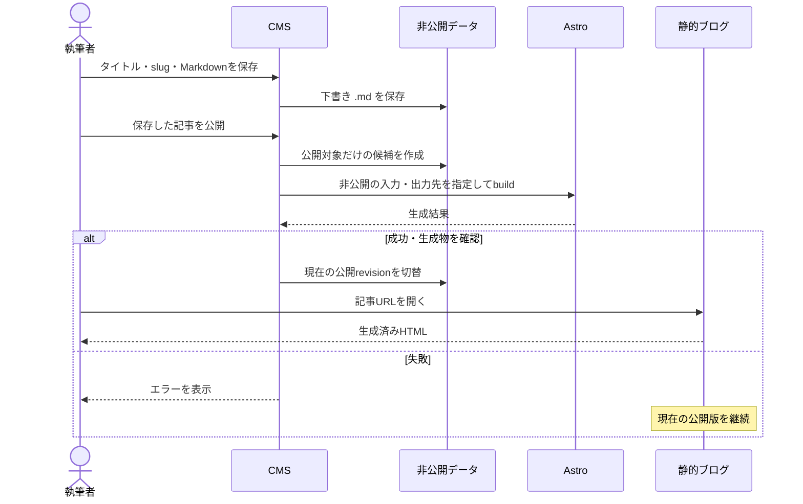

# 執筆から公開までの最小実装

[利用者向けの確認資料：動画・画像・UML・日本語の説明](review.md)

デザインを作り込まず、**書く → 下書き保存 → プレビュー → 公開 → 静的ブログを読む**流れを、このCloud環境で実装・検証した。本番のGitHub Pages公開や既存機能の移行完了を意味しない。

## 起動

Node.js 24で、両リポジトリを隣に配置する。

```sh
cd /workspace/silverbirder.github.io-new-2
npm ci
npm test
cd /workspace/silverbirder.github.io-cms
npm ci
npm start
```

- 執筆画面: <http://127.0.0.1:3000/>
- 読者用ブログ: <http://127.0.0.1:4321/>
- Markdown原稿・下書き・公開確定版・生成HTMLはCMSの `.data/` に保存する。Gitの追跡対象から除外する。
- サーバーはloopback限定。ブラウザからの更新は同じOriginとCSRFトークンを検証する。本番向けの認証・保存先は今後接続する。

## 画面と構成





公開中の記事を再編集して下書き保存しても、再公開までは読者のページを変更しない。プレビューと公開ページは同じMarkdown変換器を使う。公開ブログはHTML/CSSで読め、公開ビルド中にリンクカード情報を外部取得しない。

## 今回の範囲

最低限の必須機能は、Markdown執筆、下書き保存・再開、公開前プレビュー、ブログ公開、静的記事の閲覧。

プレビューは保存済み原稿を非公開で確認する。編集中の変更は先に保存し、プレビューから編集へ戻れる。公開ページと共通の本文変換・カード情報を使い、プレビューだけで読者用ブログへ公開されることはない。

記事一覧・記事詳細・RSS・sitemapを同じ公開対象から静的生成する。Markdownの見出し・表・タスクリスト・コード・画像・安全なHTMLを扱う。リンクカードは取得済みJSONがあればタイトル・説明・画像等を使い、未収録URLはドメイン名に縮退する。CMS起動時の同じカード情報をプレビューと公開に渡す。`index: false` は非公開ではなく、公開記事の `noindex` として扱う。

GitHub Pagesへの実配信、private Gitへの永続化、本番の認証、旧記事の全件移行、画像アップロード、計測・Webmention等の既存連携、PWA、検索・反応、メール配信は次の段階。既存の[確定要件](requirements.md)と[維持する連携](current-integrations.md)は引き続き有効。

## 動作確認

検証日: 2026-11-13。Node.js 24.22.1、Astro 7.4.11、Chromiumを使用。

| 検証 | 結果 |
| --- | --- |
| 公開側 `npm test` | 8件成功。Markdown・入力検証・サニタイズ・公開対象の判定 |
| CMS `npm test` | 14件成功。保存・再開・公開の直列化・失敗時の維持・非公開領域の保護・ビルドの停止 |
| CMS `npm run test:e2e` | Cucumber 4シナリオ・31ステップすべて成功 |
| 動作確認用記事の公開 | 保存303 → 実Astro build → 公開303 → 記事200。1記事で約3.1秒 |
| 共有Chrome | 執筆画面と実際に生成した記事ページを表示して確認 |

1記事の時間はこの環境の参考値。既存記事の全件移行・ビルド時間は未検証。

ブラウザでは、下書き保存後のCMS再起動と再開、別の下書きが生成物へ混入しないこと、カード情報を含むプレビューと公開本文HTMLの一致、JavaScript無効のスマホ幅での閲覧、再編集の下書きと公開版の分離を確認した。コピーしたテスト用プロジェクトのAstro設定を意図的に失敗させ、旧記事と公開revisionが維持されることも確認した。

シナリオはCMSの `features/publishing.feature`。テスト用原稿とカード情報は架空のデータで、外部画像の実配信は検証対象に含めず、URLと本文HTMLの一致を検証する。

CMS側で次を実行すると、画面と操作動画を `artifacts/` に再生成する。このCloud環境にある `/usr/bin/chromium`・`/usr/bin/ffmpeg` を使い、テスト・録画用データは実際の `.data/` から分離して終了後に消す。

```sh
npm test
npm run test:e2e
npm run record:demo
```

- `artifacts/cucumber.json`: 実行結果
- `artifacts/write-to-publish-natural.mp4` / `.webm`: 執筆・保存・プレビュー・公開・記事閲覧の操作動画。字幕や動画用の装飾を付けず、slowMoと自然な入力・クリック・スクロールで操作する
- `artifacts/01-writing.png` ～ `06-mobile-no-javascript.png`: 各段階の画面

これらはGitの追跡対象外。構成図とシーケンス図は上に記載した。

動画は約43秒。`slowMo: 350` と1文字65msの入力、段階的なスクロール、短い確認の間を使う。字幕・強調表示を加えずに録画し、執筆・プレビュー・公開記事の3場面を通常速度で再生して、操作を追えることを確認した。
