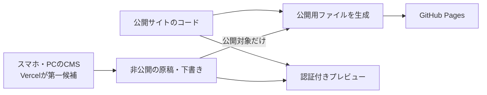

# ブログリニューアル要件

更新日: 2026-11-12

この資料を要件の基準とする。確定事項・候補・未決定事項を区別する。

## 1. 目的

ブログ全体のデザインを刷新する。記事の読みやすさ、見つけやすさ、スマホでの書きやすさ、本・サービスの案内を改善する。既存機能は、明記した削除対象を除いて維持する。

## 2. リポジトリと公開範囲

| 用途 | リポジトリ・配置先 | 方針 |
| --- | --- | --- |
| 現行サイト・最終的な公開ブログ | [silverbirder.github.io](https://github.com/silverbirder/silverbirder.github.io) | コードはpublic。GitHub Pagesで公開 |
| 公開サイトの検証・資料 | [silverbirder.github.io-new-2](https://github.com/silverbirder/silverbirder.github.io-new-2) | 本リポジトリ |
| CMSの検証 | [silverbirder.github.io-cms](https://github.com/silverbirder/silverbirder.github.io-cms) | CMSのホストはVercelが第一候補 |
| 原稿・下書き | CMSの非公開領域 | privateで管理。保存方式は未決定 |
| 公開済みの記事 | GitHub Pages | 読者がWebで閲覧できる |

公開サイト用のコードと記事原稿を分離する。CMSの認証情報を配信ファイルに含めない。検索データも公開記事だけから生成する。

## 3. 確定要件

| ID | 要件 |
| --- | --- |
| R01 | ブログ全体のデザインを刷新し、スマホでも読みやすくする |
| R02 | 既存機能と記事の表示を原則維持する |
| R03 | コードはpublic、原稿・下書きはprivateで管理する |
| R04 | スマホから執筆、下書き保存・再開、画像選択・アップロード、公開確認ができる |
| R05 | Google Photosから写真・動画を選んで取り込める |
| R06 | 画像は横幅上限1280px。縦横比と向きを維持し、小さい画像は拡大しない |
| R07 | 保存先へのアップロード前に画像をリサイズ・圧縮し、データ量を抑える。Google Photosから必要サイズで取得できるかも検証する |
| R08 | 公開画面とプレビューの表示を揃える。本文・画像・埋め込み・リンクカードを含む |
| R09 | 本・こぶりー・散歩生成の案内カードを設ける |
| R10 | ページ遷移の演出を工夫する。紹介されたVFX-JSの記事を参考にする |
| R11 | 既存実装・OSSを活用し、自作の範囲と継続費用を抑える |
| R12 | 成果物は操作動画・画面図・ボックスによる構成説明図・UML・Cucumberのシナリオと実行結果を中心に確認する |

1280pxの条件は画像に適用する。動画の解像度・容量・圧縮・配信条件は未決定。

## 4. 維持する機能

見た目や実装方法は変更できる。機能と既存データの継続を優先する。

| 分野 | 維持対象 |
| --- | --- |
| 記事一覧・検索 | 公開日順、ページング、年・タグの絞り込み、タイトル・本文検索、検索条件のURL保持 |
| 本文 | Markdown・MDX、HTML、表・タスクリスト、コードハイライト、見出しリンク |
| リンク | 外部リンクアイコン、タイトル・説明・favicon・画像付きリンクカード |
| 画像・埋め込み | 画像拡大・キャプション・画像最適化、X・Bluesky・Instagram・YouTube・CodePenの埋め込み |
| 読書・回遊 | スクロール進捗、閲覧記録、前後の記事、タグごとの関連記事 |
| 反応 | いいね・解除、コメント一覧・投稿・自分のコメント削除 |
| 共有・購読・支援 | X・Bluesky・はてブ・端末の共有、RSS、メール購読、著者フォロー、OFUSE |
| ホーム | 記事数、連続投稿日数、最新更新、自己紹介・ブログ・仕事依頼・問い合わせへの導線 |
| 自己紹介 | プロフィール、職歴、書籍・サービス・OSS・発表・技術・写真の紹介 |
| 執筆補助 | タイトル・公開日時・タグ・キーワード、タグ候補、本文からの要約生成、リンクタイトル補完 |
| 下書き | 自動保存、保存状態、一覧・再開・削除、端末間で原稿を移す手段 |
| 画像投稿 | 複数画像の選択、本文への挿入。スマホからの操作を検証 |
| 記事公開 | 下書きを確認して公開する流れ。現行はGitHub PRを作成 |
| SEO・配信 | 既存URL、canonical、記事ごとのOGP画像、構造化データ、RSS、sitemap、robots、アイコン |
| 運用 | 計測連携、設定時のいいね・コメント通知、許可ユーザーの認証 |

現在のCloudinary・localStorage・Gist・GitHub PRの継続採用は未決定。利用者の目的を満たす代替方法も比較する。

## 5. 削除する機能

| 対象 | 範囲 |
| --- | --- |
| ホームのタイムライン | メモ・共有・ブックマークの一覧。自己紹介の職歴は維持する |
| 外部投稿連携 | ZennへのPR作成、はてなブログへの下書き投稿。SNS共有・はてなブックマークは維持する |

## 6. 現行実装と移行条件

[現行リポジトリの調査対象](https://github.com/silverbirder/silverbirder.github.io/tree/54f14a4550505a09c1bef67e7449f2f90e295d55)は、2026-11-12時点のmain、コミット `54f14a4550505a09c1bef67e7449f2f90e295d55`。コード上の実装・配線を確認した。本番の外部サービス疎通は未確認。

- 管理画面は既にCMS相当の機能を持つ。全面的な作り直しを前提にしない。
- プレビューは公開側と共通の本文表示部品を使用する。現在はタブ切替時に更新する。
- 下書きの実体はブラウザのlocalStorage。Gistへの退避・復元は手動で、復元時に対象Gistを削除する。
- いいね・コメントはPostgresに保存し、記事slugにひも付く。URL・slug・反応データ・匿名識別情報の互換性を確認する。
- 記事の `title / summary / publishedAt / tags / keywords / index` と、MDX・画像URLの意味を維持する。
- `index:false` は検索エンジン向けの指定で、非公開や下書きを意味しない。
- 現行の検索JSONには本文Markdownが含まれる。新構成では下書きを除外し、必要な公開テキストだけ生成する。
- 管理画面・APIのアクセス制御は、非公開CMSの要件に合わせて確認する。
- 現行に目次やGoogle Photos連携、専用の動画アップロードがあるとは確認していない。

### 実装の参照先

- [記事一覧・検索](https://github.com/silverbirder/silverbirder.github.io/tree/54f14a4550505a09c1bef67e7449f2f90e295d55/packages/user-feature-posts/src)
- [記事詳細](https://github.com/silverbirder/silverbirder.github.io/blob/54f14a4550505a09c1bef67e7449f2f90e295d55/packages/user-feature-post-article/src/post-article.tsx)
- [本文表示・埋め込み](https://github.com/silverbirder/silverbirder.github.io/blob/54f14a4550505a09c1bef67e7449f2f90e295d55/packages/ui/src/domain/mdx-components.tsx)
- [投稿画面](https://github.com/silverbirder/silverbirder.github.io/blob/54f14a4550505a09c1bef67e7449f2f90e295d55/apps/admin/src/app/posts/new/page.tsx)
- [編集・保存](https://github.com/silverbirder/silverbirder.github.io/blob/54f14a4550505a09c1bef67e7449f2f90e295d55/packages/admin-feature-post-editor/src/post-editor.presenter.ts)
- [プレビューの共通UI](https://github.com/silverbirder/silverbirder.github.io/blob/54f14a4550505a09c1bef67e7449f2f90e295d55/packages/ui/src/domain/post-editor-layout.tsx)
- [反応データのスキーマ](https://github.com/silverbirder/silverbirder.github.io/blob/54f14a4550505a09c1bef67e7449f2f90e295d55/apps/api/src/db/schema.ts)
- [ページ遷移](https://github.com/silverbirder/silverbirder.github.io/blob/54f14a4550505a09c1bef67e7449f2f90e295d55/packages/ui/src/domain/view-transition-link.tsx)

## 7. 構成案

採用前の案。CMS製品、原稿の保存方式、プレビューの更新方式は未決定。



- CMSは「現行adminの改修」と「SveltiaなどのOSS」を比較する。
- プレビューは共通の表示部品・CSS・本文変換を利用する。CMS内の即時表示と、保存後のVercelプレビューを比較する。
- Vercelのデプロイプレビュー案では、公開側コードと非公開原稿を組み合わせる連携を検証する。
- 遷移は現行View Transitionsの拡張とVFX-JSを比較し、スマホ・対応ブラウザ・動きを減らす設定で確認する。

## 8. 未決定事項

- CMS製品、現行CMSの継続範囲、フレームワーク
- 入力中の即時プレビューが必要か、保存後の確認でよいか
- 写真・動画の保存先、未公開素材の閲覧制限、元画像の保管方針
- 画像の形式・圧縮品質、スマホ写真の形式対応
- 動画の容量上限・圧縮・配信方法
- デザインの方向性、ノートの世界観の継続、カードやバナーの配置
- 許容する月額費用と、認証・保存・配信・ビルドの利用量
- 既存原稿・下書き・ブラウザ保存データ・Git履歴の移行方法

## 9. 検証と確認資料

1. 実際の記事・本・サービスを使い、トップ・記事一覧・記事詳細・スマホ投稿のラフを比較する。
2. 写真・埋め込み・リンクカードを含む記事1本で、編集・下書き・プレビュー・公開を試す。
3. 現行CMSとOSS案の、自作する範囲・スマホ操作・保守・費用を比較する。
4. 既存記事の表示・検索・URL・反応データ・SEOを確認し、段階的に移行する。

| 確認資料 | 確認すること |
| --- | --- |
| 操作動画 | スマホ投稿、プレビュー、読書、ページ遷移 |
| 画面図・構成図・UML | 画面のつながり、役割分担、下書きから公開までの流れ |
| Cucumber | 利用者の言葉で書いた受け入れシナリオと実行結果 |

以下は受け入れシナリオの案。テストは未実装。

```gherkin
# language: ja
機能: ブログのリニューアル

  シナリオ: 既存記事を検索して読める
    前提 公開済みの記事がある
    もし 本文に含まれる言葉で検索する
    ならば 該当記事が見つかる
    かつ 既存の記事URLで本文を読める

  シナリオ: スマホの画像を縮小して保存できる
    前提 スマホで横幅4032pxの画像を選んでいる
    もし 記事へ画像を取り込む
    ならば 保存する画像の横幅は1280pxになる
    かつ 縦横比と向きが維持される

  シナリオ: 小さい画像を拡大しない
    前提 横幅800pxの画像を選んでいる
    もし 記事へ画像を取り込む
    ならば 保存する画像の横幅は800pxになる

  シナリオ: 公開前の表示を確認できる
    前提 写真とリンクカードを含む下書きがある
    もし 認証してプレビューを開く
    ならば 公開画面と同じ本文表示を確認できる
    かつ 下書きは公開サイトと検索結果に出ない
```

## 10. 参考

- [ページ遷移の参考記事](https://blog.amagi.dev/entry/vfx-js-transitions)
- [VFX-JS Transitions](https://amagi.dev/vfx-js-transitions/)
- [Sveltiaのプレビュー](https://sveltiacms.app/en/docs/ui/content-editor)
- [Sveltia Preview Workflow](https://sveltiacms.app/en/docs/workflows/preview)
- [Google Photosの素材取得](https://developers.google.com/photos/picker/guides/media-items)
