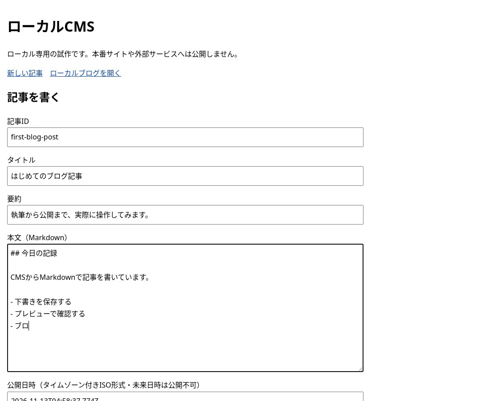
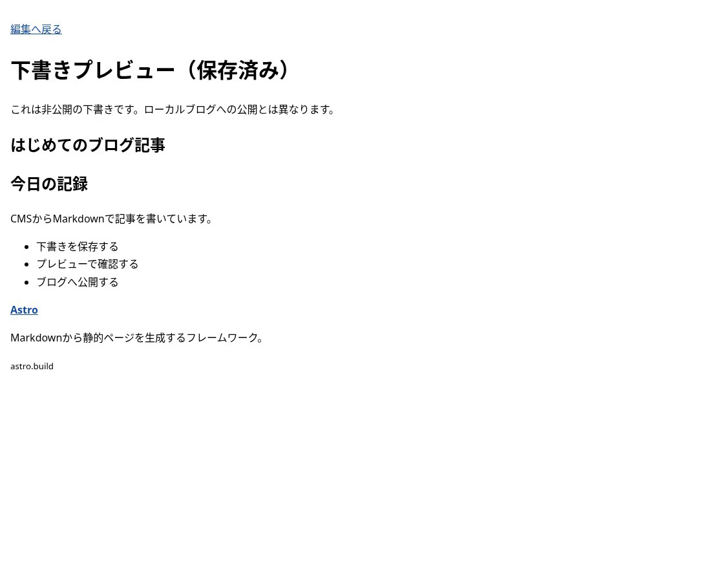
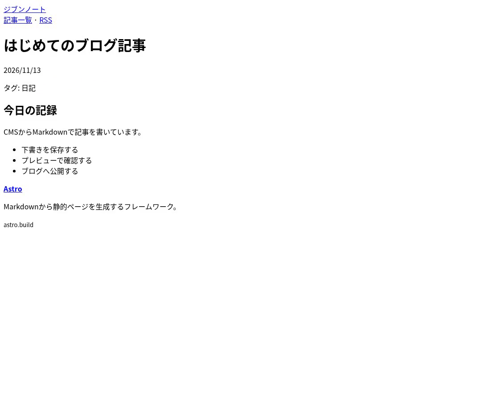
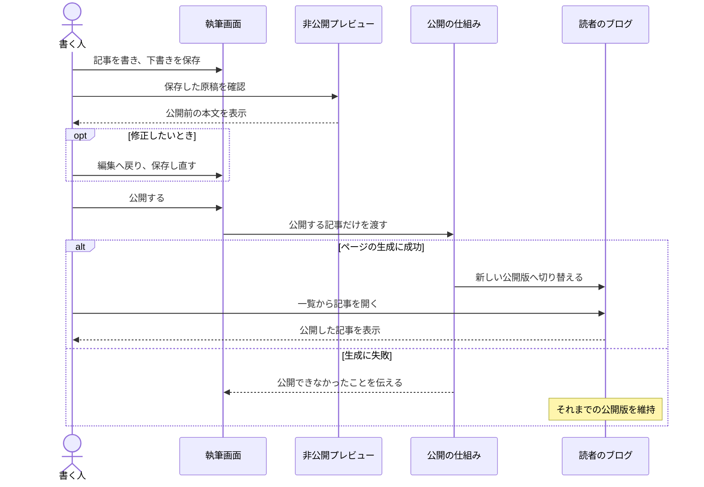

# 書いて、確認して、公開する

記事を**書く → 下書き保存 → 非公開プレビュー → 公開 → ブログで読む**ところまで動く最小構成です。プレビューも必須機能に含めています。

デザインは最低限です。現在の公開先は開発環境内で、本番ブログへの接続は次の段階です。

## 操作動画（約43秒）

[動画を開く・保存する](review/demo.mp4)

一文字ずつ入力し、スクロールして保存・確認・公開する実際の操作です。字幕や強調表示は付けていません。動画と下の画像には、動作確認用の架空の記事を使っています。

## 画面で確認

### 1. 記事を書く

タイトルと本文を入力して、下書きとして保存します。

### 2. 公開前にプレビューする

保存した原稿の表示を確認します。「編集へ戻る」から修正できます。この画面を開いても記事は公開されません。

### 3. 公開した記事を読む

公開が成功すると、読者向けの記事一覧から記事を開けます。

## 操作と公開の流れ（UML）

## 確認した結果

| 確認したこと | 結果 |
| --- | --- |
| 保存した下書きを、再起動後も開き直せる | 確認済み |
| 下書きとプレビューが読者側へ出ない | 確認済み |
| プレビューと公開ページの本文が一致する | 確認済み |
| 公開後に下書きを編集しても、再公開まで読者のページが変わらない | 確認済み |
| 公開に失敗しても、直前の公開記事を読める | 確認済み |
| JavaScriptを無効にしても記事を読める | 確認済み |

自動確認は22件、ブラウザでの確認は4シナリオ・31手順すべて成功しています。動画も通常速度で再生して、操作を追えることを確認しました。
